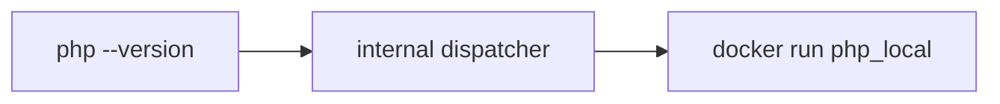

# LocEnv

**Run PHP, Node.js and Composer without installing them on your machine.**

LocEnv makes `php`, `node`, `npm`, `npx` and `composer` available as local commands backed by Docker containers. No host installation, no version managers, no environment conflicts.

[](https://docs.docker.com/get-docker/)
[](https://www.gnu.org/software/bash/)
[](#requirements)

## Why LocEnv?

- **Nothing to install on the host.** PHP, Node.js and Composer run inside Docker containers. Your system stays clean, and you can switch versions by editing a single `.env` file.
- **Zero reconfiguration.** The commands are thin shims placed in `~/.local/bin`, so every tool that looks for `php` or `node` in the `PATH` — IDEs, editors, scripts, CI hooks — finds them and works as if the executables were installed natively. No need to reconfigure VS Code, PhpStorm, or your shell profiles.
- **Same paths, same permissions.** The current directory is mounted in the container with the same path and your own UID/GID, so files created by `composer install` or `npm install` belong to you, not to root.
- **Fast and cached.** npm and Composer caches live on the host, so packages are downloaded once.
- **Dev servers just work.** Common development servers (Vite, Next.js, PHP built-in server, and many more) are detected automatically: ports are mapped and listening addresses adjusted for you.

## How it works

The public commands are thin shims. The Docker logic is centralized in a
hidden internal dispatcher, not intended for direct use.



## Quick start

```bash
git clone https://github.com/matteocastiglioni/locenv.git
cd locenv
cp .env.example .env
./build.sh
. ~/.bashrc
php --version
```

## Requirements

- Docker Engine 24.0 or higher;
- Bash;
- a normal user session; using `sudo` is not necessary;
- `~/.local/bin` in the `PATH`.

The project is designed primarily for Linux. The shims use Bash and may also work on macOS with Bash available and Docker Desktop, but macOS support is not tested automatically.

## Installation

1. Clone the repository and enter the directory:

```bash
git clone https://github.com/matteocastiglioni/locenv.git
cd locenv
```

2. Create the optional configuration:

```bash
cp .env.example .env
```

3. Build the images and install the shims:

```bash
./build.sh
```

For a non-interactive reinstallation:

```bash
./build.sh --force
```

To force a build without cache:

```bash
./build.sh --force --no-cache
```

The script:

- builds `php_local`, `node_local` and `composer_local`;
- creates the shims in `~/.local/bin` and a hidden internal dispatcher;
- adds `~/.local/bin` at the beginning of the `PATH` in the shell configuration;
- also configures the optional `dk` and `dkc` aliases;
- does not execute the `.env` file as shell code;
- does not install PHP, Node.js or Composer on the host.

After installation, open a new shell or source the configuration file indicated by the script, for example:

```bash
. ~/.bashrc
```

## Version configuration

`.env` can contain these variables:

```ini
PHP_VERSION=8.4-alpine
NODE_VERSION=22-alpine
COMPOSER_VERSION=2
IMAGE_TAG=1.0
```

The default versions are defined in the script. For better reproducibility it is recommended to use explicit tags instead of tags like `latest` or `lts`.

## Usage

Commands are executed in the current directory, mounted in the container with the same path and with the UID/GID of the host user.

```bash
# Public commands use the shims
php --version
node --version
npm install
npx eslint .
composer install
```

Arguments are kept separate, so paths or values containing spaces are also supported:

```bash
node -e 'console.log(process.argv[1])' 'value with spaces'
```

## Shim options

The shims support:

- `--locenv-root` or `--ler`: runs the process in the container as root;
- `--locenv-port PORT`: publishes the same host/container port;
- `--locenv-port HOST_PORT:CONTAINER_PORT`: publishes different ports;
- `--locenv-help` or `--leh`: shows the shim options;
- `--`: ends the parsing of the shim options and is passed to the real command.

`--help` and `-h` are not intercepted by the shim and are passed to the
real command. To display the shim help use `--locenv-help` or
`--leh`:

```bash
php --help
node -h
php --locenv-help
node --leh
```

Shim options must be given immediately after the command name:

```bash
node --locenv-port 3000 server.js
npm --locenv-port 5173 run dev
php --locenv-root -S 127.0.0.1:8000
php --ler --lep 8000 -S 127.0.0.1:8000
node --lep 3000 --lep 9229 server.js
```

When the first argument of the real command is encountered, everything that
follows is passed to the command without reinterpretation. Shim options
cannot be inserted after that point.

Examples:

```bash
php --locenv-port 8000 -S 127.0.0.1:8000
node --locenv-port 3000 server.js --locenv-port 1234
npm --lep 5173 run dev
composer --locenv-root install
```

The internal dispatcher is not a public command and must not be invoked
directly.

Interactive mode is automatically detected when stdin and stdout
are terminals. When the command is used in a pipe, the shim avoids
forcing a TTY.

Examples:

```bash
php --locenv-port 8000 -S 0.0.0.0:8000
npm --locenv-root install
npx --locenv-port 5173 vite --host 127.0.0.1 --port 5173
node --version
```

Ports are not published automatically. This avoids conflicts when running normal CLI commands like `php --version` or `npm install`.
Published ports are available only on `127.0.0.1` of the host, not on the
other network interfaces. The server in the container must still
listen on `0.0.0.0`, as in the PHP example.

### Automatic server detection

Where possible, the shims automatically recognize the most common development
servers and add the correct port mapping and listening address.
Supported, among others:

- PHP built-in server (`-S`);
- Vite and Vite Preview;
- Next.js;
- Angular CLI;
- Webpack Dev Server and Rspack;
- Parcel;
- Storybook;
- Astro, Nuxt and SvelteKit;
- Vue CLI Service and Create React App;
- Docusaurus;
- Wrangler;
- `serve`, `http-server` and `browser-sync`.

Examples that do not require explicit `--locenv-port`:

```bash
php -S 127.0.0.1:8000
npx vite --host 127.0.0.1 --port 5173
npx next dev --hostname 127.0.0.1 --port 3000
npm run dev
```

For `npm run dev` the shim reads the script from the `package.json` and tries
to recognize the framework used. Detection is intentionally
conservative: if the command or framework is not recognized, use the explicit
fallback with the shim options immediately after the command:

```bash
node --locenv-port 3000 server.js
npm --lep 5173 run dev
```

In these cases the application must be configured on its own to
listen on `0.0.0.0`. The Docker mapping alone does not change the address the
application listens on.

Shim options must always be inserted before the first argument of the real
command, for example:

```bash
npx --locenv-port 5173 vite --host 127.0.0.1 --port 5173
```

## Cache

Caches are kept on the host under:

```text
~/.cache/locenv/node
~/.cache/locenv/composer
```

This avoids re-downloading npm and Composer packages every time, without putting caches or configurations in the mounted project.

## Security and limitations

- Docker must already be installed and the daemon must be started.
- `--locenv-root` can create files owned by root in the project: use it only when necessary.
- The container has write access to the current directory because it must be able to create `node_modules`, `vendor` and other development artifacts.
- The images use configurable tags from the Docker registry; for fully reproducible builds use pinned versions and digests.
- `.env` is excluded from the Docker context via `.dockerignore`.

## Verification

After installation:

```bash
command -v php node npm npx composer
php --version
node --version
npm --version
npx --version
composer --version
```

`command -v` should show the shims under `~/.local/bin`, while the
real executables are resolved exclusively inside the containers.

## Additional scripts

The repository also contains experimental scripts for Python, CUDA and Ollama. They are not part of the main installation and are no longer configured by `build.sh`.
